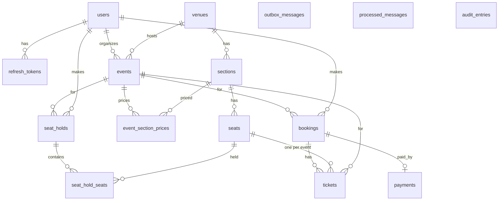

# Event Ticketing Platform (CIT4242 Final Project)

A ticketing backend for concerts and conferences. The main rule: **two people must never buy the same seat.**

Stack: Java 21, Spring Boot 3.5.16, PostgreSQL 16, Redis 7, RabbitMQ 3, Flyway, Testcontainers, Checkstyle, JaCoCo.

## How to build and run

You need Java 21 and Docker. Maven does not have to be installed because the wrapper is included.

```bash
./mvnw clean verify
```

This compiles the code, runs every unit and integration test (the integration tests start PostgreSQL, Redis and
RabbitMQ in Docker with Testcontainers), runs the Checkstyle gate and writes the coverage report to
`target/site/jacoco/index.html`.

To start the whole system:

```bash
cp .env.example .env
docker compose up --build
```

- API: http://localhost:8080
- Health: http://localhost:8080/actuator/health (shows `db`, `redis` and `rabbit` separately)
- RabbitMQ UI: http://localhost:15672 (login from `.env`)

To run from the IDE, start only the infrastructure (`docker compose up postgres redis rabbitmq`) and run
`TicketingApplication` with the `dev` profile. Dev has a short hold TTL (2 minutes) and shows SQL.

### Profiles

| Profile | Used for | What is different |
|---|---|---|
| dev | laptop | show-sql, DEBUG logging, hold TTL 2m, dev defaults for DB and JWT secret |
| test | integration tests | Testcontainers give the URLs, Flyway runs on an empty database |
| prod | demo / Docker | no secrets in files (all from env), JSON (ECS) logs, Hibernate statistics off |

### Seeded accounts

All seeded users have the password `Password123!`.

| Email | Role |
|---|---|
| admin@kimep.kz | ADMIN |
| organizer.one@kimep.kz | ORGANIZER (owns events 1, 2, 4, 5, 9) |
| organizer.two@kimep.kz | ORGANIZER (owns events 3, 6, 7, 8, 10) |
| customer1@kimep.kz ... customer5@kimep.kz | CUSTOMER |

Seed data (`V2__seed_data.sql`): 3 venues, 7 sections, **1,986 seats**, 10 events (past, on sale, sold out, draft),
15 bookings in different statuses with tickets and payments.

### Trying the main flow

```bash
TOKEN=$(curl -s -X POST localhost:8080/api/v1/auth/login -H 'Content-Type: application/json' \
  -d '{"email":"customer1@kimep.kz","password":"Password123!"}' | jq -r .accessToken)

curl -s -X POST localhost:8080/api/v1/holds -H "Authorization: Bearer $TOKEN" -H 'Content-Type: application/json' \
  -d '{"eventId":4,"seatIds":[1200,1201]}'

curl -s -X POST localhost:8080/api/v1/bookings -H "Authorization: Bearer $TOKEN" -H 'Content-Type: application/json' \
  -d '{"holdReference":"H-..."}'

curl -s -X POST localhost:8080/api/v1/payments -H "Authorization: Bearer $TOKEN" -H 'Content-Type: application/json' \
  -d '{"bookingReference":"B-...","method":"CARD","cardToken":"tok_visa"}'
```

The payment gateway is simulated (`SimulatedPaymentGateway`). Any card token that starts with `decline` is declined
with 402. Other tokens are approved.

## Package structure

```
kz.kimep.ticketing
├── catalog     events, venues, sections, seats, seat map
├── booking     holds, bookings, tickets, sales summary
├── payment     payments and the gateway
├── identity    users, JWT, refresh tokens, security config
├── messaging   outbox, RabbitMQ topology, consumers
└── shared      errors, config, audit log, correlation id filter
```

Each feature has `api`, `domain`, `repo` and `service` inside it. Checkstyle `ImportControl`
(`config/checkstyle/import-control.xml`) fails the build if a feature imports another feature's `domain` or `repo`.
Because of that rule, entities do not have JPA relations across features. For example `Ticket` stores `seatId` and
`eventId` as columns (with real foreign keys in the database) instead of `@ManyToOne Seat`. Inside one feature the
relations are normal JPA relations (`Venue -> Section -> Seat`, `Booking -> Ticket`). When booking needs catalog data
it calls `EventSeatCatalog`, and when catalog needs to know which seats are taken it calls the `SeatStatusSource`
interface, which booking implements.

## ER diagram



`tickets` has `uq_ticket_event_seat (event_id, seat_id)`, so the database itself refuses a second ticket for the same
seat at the same event.

## REST API

| Method | Endpoint | Role |
|---|---|---|
| POST | /api/v1/auth/register, /login, /refresh | public |
| POST | /api/v1/auth/logout | any logged in |
| GET | /api/v1/events (filters: city, from, to, status; paged) | public |
| GET | /api/v1/events/{id}, /{id}/availability, /{id}/seats | public |
| POST, PUT | /api/v1/events, /api/v1/events/{id} | ORGANIZER (own events only) |
| POST | /api/v1/events/{id}/publish | ORGANIZER (own events only) |
| GET | /api/v1/venues, /api/v1/venues/{id} | public |
| POST, PUT | /api/v1/venues, /api/v1/venues/{id} | ADMIN |
| POST | /api/v1/holds | CUSTOMER |
| GET, DELETE | /api/v1/holds/{reference} | owner |
| POST, GET | /api/v1/bookings | CUSTOMER |
| GET | /api/v1/bookings/{reference} | owner |
| POST | /api/v1/bookings/{reference}/cancel | owner |
| POST | /api/v1/payments | owner |
| GET | /api/v1/tickets/{code} | owner, organizer of the event, admin |
| GET | /api/v1/organizer/events/{id}/sales | ORGANIZER (own events only) |

Roles are hierarchical: ADMIN > ORGANIZER > CUSTOMER. Every non-public endpoint has `@PreAuthorize`, and ownership is
checked in the service (`EventOwnership`, `BookingLifecycleService.findOwned`, `HoldService.findOwned`).

Status codes: hold created 201 + `Location`, seat taken 409, hold expired 410, cancel 204, payment declined 402, too
many seats 400, somebody else's booking **404 not 403** (403 would tell the caller that the booking exists). Every list
is paged and `spring.data.web.pageable.max-page-size: 50` caps the page size, so `size=10000` returns 50 rows.

Every error has one shape (`ApiError`):

```json
{"timestamp":"...","status":404,"error":"Not Found","message":"Event 9999 was not found.","path":"/api/v1/events/9999","fieldErrors":[]}
```

## Seat holds and concurrency

Three layers, from first to last:

1. **Redis `SET NX PX`** (`RedisSeatLockStore.tryLock`). Key `hold:{eventId}:{seatId}`, value is the hold reference, TTL
   is `ticketing.hold-ttl`. Redis decides the winner atomically, so there is no check-then-act gap.
2. **`@Version` on `Booking`.** `BookingLifecycleService.confirmPaid` compares the version read before payment with
   the current one. A stale write throws `OptimisticLockingFailureException`, which becomes 409.
3. **`uq_ticket_event_seat`.** The backstop if both of the above were wrong.

Hold flow in `HoldService.createHold`: validate (400), lock every seat in sorted order (all or nothing, see
`SeatLockService.lockAll`, which releases the keys it already took before answering 409), check no ticket exists,
save the `SeatHold` row, and release all keys if anything fails. Expiry is just the Redis TTL, with no cleanup job
deciding when a seat is free. The `SeatHold` row keeps the record, and `HoldReconciler` puts back missing Redis keys on
startup (for when Redis restarted) and marks old holds as EXPIRED. Booking (`BookingService.createBooking`) locks the hold
row, checks it is still active and still owns its Redis keys (410 if not), creates the booking and tickets in one
transaction, and deletes the Redis keys only **after commit** (`AfterCommit`).

Unpaid bookings expire after `ticketing.payment-window` (15m) by `UnpaidBookingCanceller`, and their seats are released.

## Caching

| Cache | TTL | Evicted by |
|---|---|---|
| `event` (event detail) | 15m | `EventOrganizerService.update/publish` |
| `eventList` (per filter + page) | 5m | any event create/update/publish (`allEntries`) |
| `venue` | 1h | `VenueService.update` |
| `availability` (free count per section) | 30s | not evicted, the short TTL is the design |

Holds, the seat map and single seat state are **never cached**. `EventCacheTest` shows a cached read (a direct DB
change is not visible), then an update through the API, then the next read showing the change.

## Messaging

Exchange `ticketing.events` (topic), queues `ticketing.booking.confirmed`, `ticketing.booking.cancelled`,
`ticketing.payment.failed`, each with `x-dead-letter-exchange = ticketing.dlx`, which routes to `ticketing.dlq`.

- **Outbox:** `OutboxWriter.write` is `Propagation.MANDATORY`, so it can only run inside the business transaction.
  `OutboxPublisher` sends unpublished rows every 2s with `messageId = outbox-{id}`.
- **Retry:** 4 attempts, 1s/2s/4s backoff (`spring.rabbitmq.listener.simple.retry`). After that
  `AlertingMessageRecoverer` logs an `ALERT` and rejects the message, so it goes to the DLQ.
- **Idempotency:** `ProcessedMessageGuard.runOnce` saves the message id in `processed_messages` (unique) in the same
  transaction as the work. A repeat is ignored.
- **RabbitMQ down:** the API keeps selling. Rows stay in `outbox_messages` and go out when the broker is back.

## Clean code and SOLID

`./mvnw clean verify` fails on any Checkstyle violation (`config/checkstyle/checkstyle.xml`): method length 30,
file length 300, max 5 parameters, cyclomatic complexity 10, nesting depth 3, magic numbers, unused imports and
variables, star imports, TODO comments, field `@Autowired` (the import is banned), the banned class-name words
(Manager, Helper, Util, Data, Processor, Info) and the package dependency rule. **There are no suppressions.**
Dependencies use constructor injection (Lombok `@RequiredArgsConstructor`, all fields `final`).

**S - Single responsibility.** `PaymentService` had two reasons to change: how we talk to the gateway (timeouts,
errors) and how we store the result. We split it, so `PaymentService` only calls the gateway with a timeout and
`PaymentRecorder` only saves the payment and confirms the booking in one transaction. In the same way the event code
is split into `EventCatalogService` (public reads and caching) and `EventOrganizerService` (organizer writes and
cache eviction).

**O - Open/closed.** Fees are `FeeRule` implementations. `BookingPricing` gets a `List<FeeRule>` from Spring and adds
them up. To add a new fee we add a new `@Component` class and do not edit `BookingPricing`. The test
`BookingPricingTest.everyFeeRuleIsAddedWithoutChangingThePricingClass` does exactly this. New payment providers work
the same way through `PaymentGateway`.

**L - Liskov substitution.** `SeatLockService` uses the `SeatLockStore` interface. `RedisSeatLockStore` (production)
and `InMemorySeatLockStore` (tests) both follow the same contract: `tryLock` only succeeds when no unexpired lock
exists, and `release` only deletes your own lock. `SeatLockService` cannot tell which one it got, and all of
`SeatLockServiceTest` passes against the in-memory store. This is our only real substitution example.

**I - Interface segregation.** Catalog only needs one thing from booking: which seats are held or sold. So
`SeatStatusSource` has exactly one method, `occupancy(eventId)`, and does not expose booking queries catalog has no
use for. `SeatLockStore` has three methods and both implementations use all three. To be honest, we designed these
interfaces small from the start instead of splitting a big one later.

**D - Dependency inversion.** `HoldService` depends on `SeatLockService`, which depends on the `SeatLockStore`
interface and never creates a Redis client itself. In production Spring injects `RedisSeatLockStore`. In
`HoldServiceTest` and `SeatHoldConcurrencyTest` we pass `InMemorySeatLockStore`. `PaymentService` depends on
`PaymentGateway`. Production gets `SimulatedPaymentGateway`, and `PaymentServiceTest` passes lambdas, including one
that never answers so we can test the timeout.

## Performance note

**N+1 found:** `GET /api/v1/events` ran **52 queries for a page of 50** (1 select, 1 count and 1 per venue). The
count grew with the page size: 12 for 10 rows, 22 for 20 rows.

**Change:** added `@EntityGraph(attributePaths = "venue")` to `EventRepository.findAll(Specification, Pageable)`.

**After:** **2 queries for any page size** (select with join + count), confirmed by `EventQueryCountTest`.

Measured on a local PostgreSQL 16 with the seed data plus 60 extra events, each in its own venue. The average of 20
requests to `GET /api/v1/events?size=50` (cache disabled, numbers from Hibernate `show-sql`):

| | queries (size 10 / 20 / 50) | avg response, size 50 |
|---|---|---|
| before (no entity graph) | 12 / 22 / 52 | 10.8 ms |
| after (entity graph) | 2 / 2 / 2 | 5.3 ms |

One thing we learned: with only the 3 seeded venues, the lazy version ran 5 queries for every page size, because
Hibernate reuses a venue it already loaded. So the first version of our query-count test would **not** have failed
without the entity graph. Now the test creates 60 events with 60 different venues, so removing the graph makes the
query count grow and the test fail.

Other rules followed: every `@ManyToOne` is `LAZY`, lists are paged with a server max, filtering is done in SQL
(Specifications), the seat map loads seats for all sections in one query and groups them in memory, and availability
uses `GROUP BY` count queries.

**Indexes** (`V1__create_schema.sql`):

| Index | Column(s) | Serves |
|---|---|---|
| idx_events_venue, idx_events_organizer | venue_id, organizer_id | joins, ownership |
| idx_events_status, idx_events_starts_at | status, starts_at | list filters and sort |
| idx_venues_city | city | city filter |
| idx_sections_venue | venue_id | sections of a venue |
| uq_seat_position | section_id, row_label, seat_number | seats of a section |
| uq_ticket_event_seat | event_id, seat_id | sold seats of an event, double-sale guard |
| idx_tickets_booking, idx_tickets_seat | booking_id, seat_id | tickets of a booking |
| idx_bookings_event, _user, _status | event_id, user_id, status | my bookings, sales, expiry job |
| idx_seat_holds_event, _user, _status_expires | event_id, user_id, (status, expires_at) | active holds |
| idx_seat_hold_seats_seat | seat_id | held seats |
| idx_outbox_unpublished | created_at where published_at is null | outbox publisher |

## Testing

- **Unit (64):** services with mocks or fakes: hold validation, all-or-nothing locking, TTL edges (599s held, 600s
  expired), pricing, status changes, cancellation policy, stale version, payment decline and timeout, JWT, BCrypt,
  ownership, idempotency, outbox with RabbitMQ down.
- **Concurrency:** `SeatHoldConcurrencyTest` (300 races per test with a latch, always exactly one winner) and
  `SeatConcurrencyTest` (two real HTTP requests against Redis: one 201, one 409, one ticket).
- **Integration (41, Testcontainers PostgreSQL + Redis + RabbitMQ):** auth flow, event API, holds, booking and
  payment flow, async ticket issue, cancel and release, organizer A gets 404 on organizer B's sales, cache
  invalidation, DLQ, redelivery changes nothing, hold expiry by TTL only, unique constraint, seed volume, health.
- **Query count:** `EventQueryCountTest`.

No test uses `Thread.sleep`. Async results are awaited with Awaitility. If Docker is missing, the integration tests are
skipped (`@Testcontainers(disabledWithoutDocker = true)`). CI fails if any test was skipped, so in CI they always run.

## CI and branch protection

`.github/workflows/ci.yml` runs `./mvnw -B clean verify` on every push and pull request (Checkstyle + all tests with
Testcontainers), fails if any test was skipped, and uploads the JaCoCo and test reports as artifacts.

Branch protection is set in GitHub, not in code: Settings -> Branches -> add a rule for `main` -> require a pull request
with 1 approval, require the `build` status check to pass, and do not allow direct pushes.

## Logging, health and timeouts

- `CorrelationIdFilter` puts `X-Correlation-Id` (or a new UUID) in the MDC and the response header. Prod logs are
  JSON (ECS).
- Request DTOs that hold secrets (`LoginRequest`, `RegisterRequest`, `RefreshRequest`, `TokenResponse`,
  `PaymentRequest`, `ChargeRequest`) override `toString()` so passwords, tokens and card tokens never end up in logs.
  Responses never contain the password hash.
- Timeouts: Hikari 5s, JPA query 5s, Redis 2s, RabbitMQ connection 3s and template 5s, payment gateway 5s
  (`PaymentService.chargeWithTimeout`). The hold TTL (10m) is longer than the payment timeout.

## Known limitations

- Cancelling a CONFIRMED booking does not refund money (refunds are optional module 2, not built).
- `payment.failed` only notifies the customer. The booking stays `PENDING_PAYMENT` so they can retry, and the seats
  are released when the payment window passes.
- Emails are logged by `LoggingNotifier` (the real email module is optional).
- No optional modules are built.
